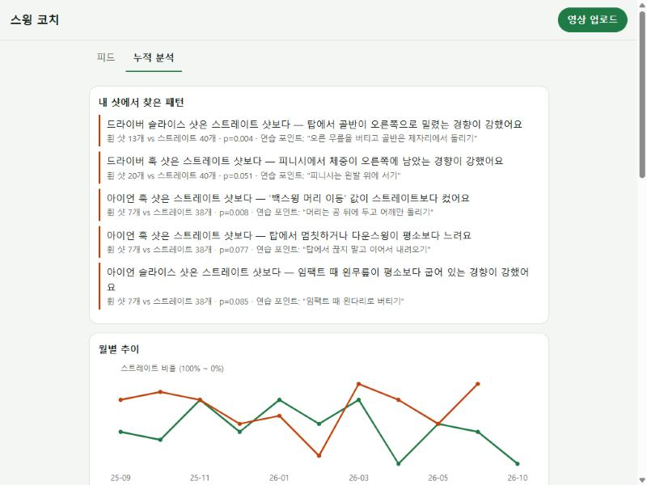
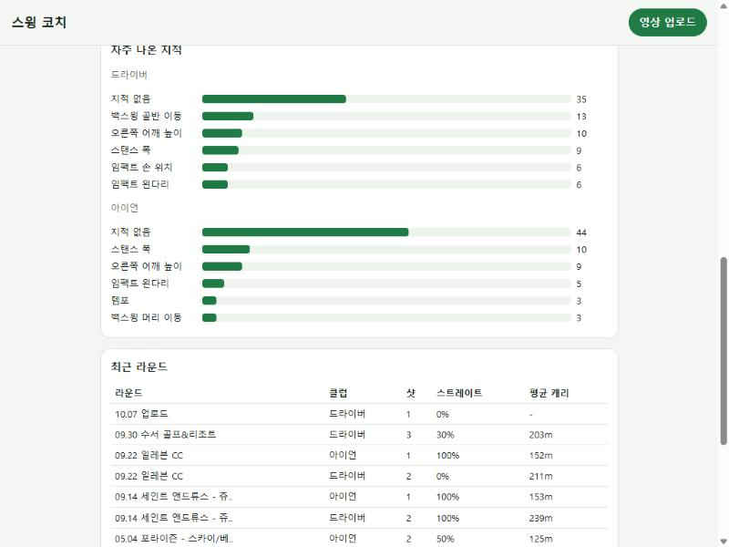
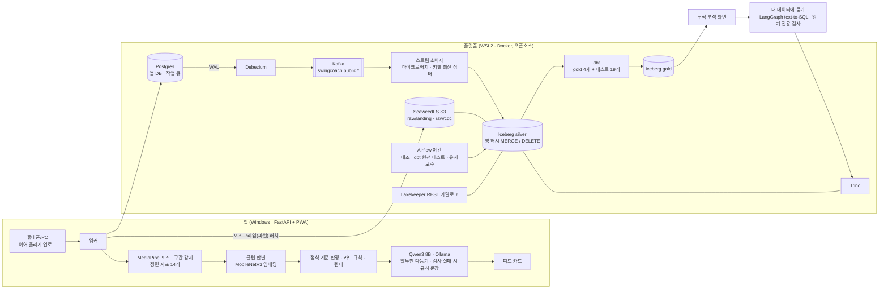

# Swing Coach — 스크린골프 스윙 영상 티칭 & 실시간 레이크하우스

스크린골프 정면 스윙 영상을 순서대로 업로드하면, 영상마다 "옆에서 지켜본 선생님"처럼 **정석 기준 판정(잘함/보통/아쉬움)과 잘한 점 1개 · 고칠 점 1개 · 다음 샷 한마디**가 그림과 함께 피드에 쌓이고, 쌓인 샷으로 "내 슬라이스는 어떤 동작과 관련 있나"를 찾아주는 개인용 서비스. 앱의 모든 변경은 **CDC로 수 초 안에 Iceberg 레이크하우스에 반영**된다. 로컬 LLM이 카드 말투를 다듬고(숫자·기준이 바뀌면 버림), "9월 드라이버 슬라이스 몇 번?" 같은 질문을 읽기 전용 SQL로 답한다. 전 구간 오픈소스, 데스크탑 1대(16GB RAM, RTX 3060)에서 동작.

> **EN** — Upload face-on screen-golf swing videos in order; each gets a short coaching card (pose overlay vs. your reference swing, one strength, one fix, one cue). The app's Postgres streams every change through **Debezium → Kafka → a micro-batch consumer → Apache Iceberg** (SeaweedFS · Lakekeeper · Trino) in ~3–5 s, with offsets committed only after the lake write (at-least-once + idempotent MERGE). dbt owns the gold marts and their tests; Airflow runs a nightly batch reconcile (0 diffs vs. the stream), dbt source tests and Iceberg maintenance. A local LLM (Qwen3 8B on Ollama) rewrites card wording under guards (same numbers, same comparison anchors, Korean only — otherwise the rule text stays) and answers questions over the lakehouse with a LangGraph text-to-SQL agent (read-only SQL guard, answers must quote only result numbers; 12/15 execution accuracy, stable over 3 runs). Example finding: *driver slices correlate with backswing pelvis sway, p = 0.004*. 100% open source, one desktop.

| 누적 분석 — 내 샷에서 찾은 패턴 | 누적 분석 — 지적 빈도 · 라운드 요약 |
|---|---|
|  |  |

## 아키텍처



## 결과

| 항목 | 결과 | 검증 방법 |
|---|---|---|
| 업로드 → 카드 | 2~6초 (목표 60초) | E2E `tests/e2e_resumable_upload.py` |
| 앱 변경 → Iceberg (CDC) | 2.5~4.8초 (수정일시 없는 변경·삽입·삭제 포함) | E2E `tests/e2e_cdc.py` |
| 장애 복구 | 레이크 커밋 후 오프셋 커밋 전 종료 → 재전달 1건, 변경 0건 | E2E `tests/e2e_stream_recovery.py` |
| 스트림 vs 배치 대조 | 앱 테이블 4개 차이 0건 | `pipeline/run.py` (Airflow 야간) |
| 구간 감지 | 탑 평균 오차 1.7프레임(60fps, ±3 이내 93%), 임팩트 2.1, 시작 2.9 | 정답 30개 `scripts/eval_phases.py` |
| 클럽 판별 | 93.5%, 확신도 ≥0.8만 판정 시 샷 93%를 95.5% | 5-fold 층화 CV `scripts/train_club.py` |
| 피니시 지표 | 검출 프레임 오차의 영향 0.79 → 0.22 어깨너비 (피니시 0.3초 구간 중앙값) | 정답 30개 |
| 구간 감지 실패 | 193개 중 2개 (+ 퍼팅·어프로치 3개는 "풀스윙 아님" 카드) | `scripts/build_feed.py` 리포트 |
| 정석 기준 판정 | 드라이버 스트레이트 비율 잘함 67% · 보통 61% · 아쉬움 39% (방향 일치, 유의하지 않음 p=0.25), 아이언은 관계 없음 | 골프존 구질 169샷 `scripts/eval_rubric.py` |
| 구질 연관 | 드라이버 슬라이스 ↔ 백스윙 골반 밀림 (효과 크기 −1.1, p=0.004) 외 4개 | Mann-Whitney U |
| 카드 문장 다듬기 (LLM) | 30장 중 25장 채택 (83%), 거절 5장은 규칙 문장 유지 | `scripts/eval_polish.py` |
| 내 데이터에 묻기 (text-to-SQL) | 실행 정확도 8/15 (스키마만) → 12/15 (의미 규칙), seed 고정 3회 모두 12/15 · 질문당 1.5초 · DELETE 요청 3회 모두 차단 | `scripts/eval_ask.py --repeat 3` |
| 데이터 품질 | 파이프라인 검사 23개 + dbt 테스트 19개 (gold) / 10개 (원천) | `lakehouse.ops.dq_results`, `dbt build` |
| 단위 테스트 | 31 / 31 | `pytest` |

## 설계 판단 (ADR)

- **[001 데스크탑 위 레이크하우스](docs/adr/001-lakehouse-on-desktop.md)** — 수정일시 증분 대신 행 내용 해시 + MERGE. 값만 바뀐 행을 정확히 잡고 Iceberg 스냅샷으로 이전 값 조회.
- **[002 클럽 판별](docs/adr/002-club-classifier.md)** — 자세 특징 82.7% → 사전학습 이미지 임베딩 결합 91.1% → 어드레스 3프레임 평균 93.5%. 확신도 낮으면 판정 보류.
- **[003 착지 구역 타입 계약](docs/adr/003-landing-data-contract.md)** — NULL 때문에 바뀐 타입으로 MERGE가 깨진 사건 → 열 타입 고정 + 드리프트 시 silver 재구축.
- **[004 CDC 스트림 · dbt · Airflow](docs/adr/004-cdc-stream-dbt-airflow.md)** — 배치와 같은 변환 코드를 쓰는 직접 만든 소비자, 레이크 커밋 후 오프셋 커밋, 배치는 야간 대조로 역할 변경.
- **[005 로컬 LLM](docs/adr/005-local-llm-guarded.md)** — LLM은 말투만, 진단은 규칙. 숫자는 맞는데 일본어였던 출력, 비교 기준이 빠진 문장, 규칙을 더하자 떨어진 정확도, 같은 프롬프트에서 흔들린 점수.
- **[006 정석 기준 판정](docs/adr/006-textbook-verdict.md)** — 연구·투어 측정치로 만든 범위로 핵심 지표만 판정, 2D에서 편향되는 지표는 참고만. 판정을 내 데이터에 맞춰 조정하지 않은 이유.
- 측정할 수 없는 것은 말하지 않는다 — 정면 카메라에서 왜곡되는 탑 왼팔 각도는 지표에서 제외, 신뢰도 낮은 스윙은 지적 생략.

## 구조

```
src/swing_coach/   video · pose · phases · metrics · club · baseline · coach · render · store(Postgres/SQLite) · engine · rubric(정석 판정) · insights · llm · ask · app
web/               PWA (피드 · 누적 분석 · 내 데이터에 묻기)
pipeline/          extract · transform(MERGE) · quality · run(배치 대조) · stream(CDC 소비자)
dbt/               gold 모델 4개, 원천·gold 테스트
orchestration/     Airflow DAG (대조 → dbt 원천 테스트 → Iceberg 유지보수)
platform/          docker-compose (Postgres, SeaweedFS, Lakekeeper, Trino, Kafka, Debezium, Airflow), 부트스트랩
scripts/           포즈 추출 · 피드 적재 · 모델 학습 · 구간 평가/튜닝 · LLM·판정 평가 · 자동 시작 · 라벨링 도구
tests/             단위 테스트 + E2E (이어 올리기, CDC, 장애 복구)
docs/              MVP_SPEC (구현 현황), adr/, portfolio/
```

## 실행

```bash
uv sync
uv run --no-sync python platform/init_secrets.py        # 로컬 전용 키 생성 (git 제외)
wsl -d Ubuntu-24.04 -- bash -lc "cd platform && docker compose --env-file .env up"   # 붙은 상태로 두면 WSL이 꺼지지 않음
uv run --no-sync python platform/bootstrap.py           # 버킷 · Iceberg 웨어하우스 (최초 1회)
uv run --no-sync python platform/migrate_app_db.py      # SQLite → Postgres 앱 DB · airflow DB (최초 1회)
uv run --no-sync python platform/register_cdc.py        # Debezium 커넥터 등록

ollama pull qwen3:8b                                    # 선택: 없으면 규칙 문장만, 질문 기능 꺼짐
uv run --no-sync python scripts/serve.py                # 앱 http://localhost:8000
uv run --no-sync python pipeline/stream.py              # CDC 소비자 (상시)
uv run --no-sync python pipeline/run.py                 # 배치 대조 (Airflow가 매일 03:00 실행)
uv run --no-sync pytest
```

| 서비스 | 주소 |
|---|---|
| 앱 | http://localhost:8000 |
| Trino | http://localhost:8080 |
| Airflow | http://localhost:8090 (로컬 전용, 로그인 없음) |
| Ollama | http://localhost:11434 |
| Kafka (호스트) / Debezium Connect | localhost:9094 / http://localhost:8083 |

| 계층 | 테이블 |
|---|---|
| raw.landing / raw.cdc | 배치 스냅샷 / CDC 마이크로배치 parquet (외부 테이블) |
| lakehouse.silver | fact_video, fact_swing, fact_card, dim_reference, fact_pose_frame |
| lakehouse.gold (dbt) | round_summary, metric_by_flight, fix_frequency, monthly_trend |
| lakehouse.ops | pipeline_runs, dq_results, stream_batches |

## 데이터 정책

- 스윙 영상, 포즈, 라벨, 학습된 모델(`nasmo/`, `data/`, `label/`, `models/`)은 개인 데이터라 저장소에 포함하지 않는다.
- 사람이 찍힌 화면 캡처는 공개하지 않는다. 배경 인물은 분석 대상에서 제외한다.
- 접속 키는 `platform/init_secrets.py`로 로컬에서 생성하며 커밋하지 않는다.
