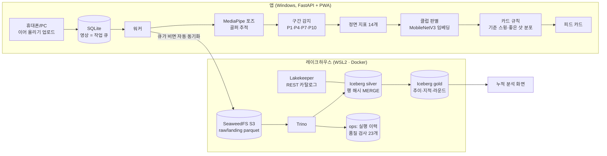

# Swing Coach — 스크린골프 스윙 영상 티칭 & 레이크하우스

스크린골프 정면 스윙 영상을 순서대로 업로드하면, 영상마다 "옆에서 지켜본 선생님"처럼 **잘한 점 1개 · 고칠 점 1개 · 다음 샷 한마디**가 그림과 함께 피드에 쌓이고, 쌓인 샷으로 "내 슬라이스는 어떤 동작과 관련 있나"를 찾아주는 개인용 서비스. 전 구간 오픈소스, 데스크탑 1대(16GB RAM, RTX 3060)에서 동작.

> **EN** — Upload face-on screen-golf swing videos in order; each gets a short coaching card (pose overlay vs. your reference swing, one strength, one fix, one cue). Accumulated shots feed an Apache Iceberg lakehouse (SeaweedFS · Lakekeeper · Trino) with hash-based MERGE, a data contract, and 23 data-quality checks, which powers a cumulative analysis view (e.g. *driver slices correlate with backswing pelvis sway, p = 0.004*). 100% open source, runs on one desktop.

| 누적 분석 — 내 샷에서 찾은 패턴 | 누적 분석 — 지적 빈도 · 라운드 요약 |
|---|---|
|  |  |

## 아키텍처



## 결과

| 항목 | 결과 | 검증 방법 |
|---|---|---|
| 업로드 → 카드 | 2~6초 (목표 60초) | E2E (`tests/e2e_resumable_upload.py`) |
| 구간 감지 | 탑 평균 오차 1.7프레임(60fps, ±3 이내 93%), 임팩트 2.1, 시작 2.9 | 수작업 정답 30개 (`scripts/eval_phases.py`) |
| 템포 | 평균 오차 0.54 (정답 중앙값 3.72:1) | 같은 정답 |
| 클럽 판별 | 91.1%, 확신도 ≥0.8만 판정 시 샷 91%를 94.8% | 5-fold 층화 교차검증 (`scripts/train_club.py`) |
| 구질 연관 | 드라이버 슬라이스 ↔ 백스윙 골반 밀림 (효과 크기 −1.1, p=0.004) 외 4개 | Mann-Whitney U |
| 레이크하우스 | 포즈 142만 행 포함 1회 약 21초, 재실행 변경 0건, 품질 검사 22 통과 · 1 경고 | `lakehouse.ops.pipeline_runs`, `dq_results` |
| 단위 테스트 | 13 / 13 | `pytest` |

## 설계 판단 (ADR)

- **[001 데스크탑 위 레이크하우스](docs/adr/001-lakehouse-on-desktop.md)** — 원천에 믿을 만한 수정 시각이 없어 *수정일시 증분 대신 행 내용 해시 + MERGE*. 값만 바뀐 행 1건을 정확히 잡고, Iceberg 스냅샷으로 변경 전 값 조회.
- **[002 클럽 판별](docs/adr/002-club-classifier.md)** — 자세 특징 82.7% → 사전학습 이미지 임베딩 결합 91.1%. 틀린 지적보다 지적 없음이 낫다고 보고 확신도 낮으면 판정 보류.
- **[003 착지 구역 타입 계약](docs/adr/003-landing-data-contract.md)** — 첫 업로드에서 NULL 때문에 정수 열이 실수로 추론되어 MERGE 실패 → 열 타입 고정 + 타입 드리프트 시 silver 재구축.
- 측정할 수 없는 것은 말하지 않는다 — 정면 카메라에서 왜곡되는 탑 왼팔 각도는 지표에서 제외, 신뢰도 낮은 스윙은 지적 생략.

## 구조

```
src/swing_coach/   video · pose · phases · metrics · club · baseline · coach · render · store · engine · insights · app
web/               PWA (피드 · 누적 분석)
pipeline/          extract(착지 parquet) → transform(silver MERGE, gold) → quality → run
platform/          docker-compose (SeaweedFS, Postgres, Lakekeeper, Trino), 부트스트랩
scripts/           포즈 추출 · 피드 적재 · 모델 학습 · 구간 평가/튜닝 · 라벨링 도구
tests/             단위 테스트 + 이어 올리기 E2E
docs/              MVP_SPEC (구현 현황 포함), adr/
```

## 실행

```bash
uv sync
uv run --no-sync python scripts/extract_poses.py          # 포즈 추출 (영상당 약 7초, CPU)
uv run --no-sync python scripts/build_feed.py --reset     # 영상 적재 + 카드 생성 + 분석 리포트
uv run --no-sync python scripts/train_club.py --save      # 드라이버/아이언 판별 모델 학습·비교
uv run --no-sync python scripts/serve.py                  # http://localhost:8000 (--host 0.0.0.0: 같은 Wi-Fi 휴대폰)
uv run --no-sync pytest
```

레이크하우스 (WSL2 + Docker):

```bash
uv run --no-sync python platform/init_secrets.py        # 로컬 전용 키 생성 (git 제외)
wsl -d Ubuntu-24.04 -- bash -lc "cd platform && docker compose --env-file .env up -d"
uv run --no-sync python platform/bootstrap.py           # 버킷·웨어하우스 생성 (최초 1회)
uv run --no-sync python pipeline/run.py                 # 추출 → silver MERGE → gold → 품질 검사
```

| 계층 | 테이블 |
|---|---|
| raw.landing | videos, swings, cards, reference, pose_frame (parquet 외부 테이블) |
| lakehouse.silver | fact_video, fact_swing, fact_card, dim_reference, fact_pose_frame |
| lakehouse.gold | round_summary, metric_by_flight, fix_frequency, monthly_trend |
| lakehouse.ops | pipeline_runs, dq_results |

## 데이터 정책

- 스윙 영상, 포즈, 라벨, 학습된 모델(`nasmo/`, `data/`, `label/`, `models/`)은 개인 데이터라 저장소에 포함하지 않는다.
- 사람이 찍힌 화면 캡처는 공개하지 않는다. 배경 인물은 분석 대상에서 제외한다.
- 접속 키는 `platform/init_secrets.py`로 로컬에서 생성하며 커밋하지 않는다.
